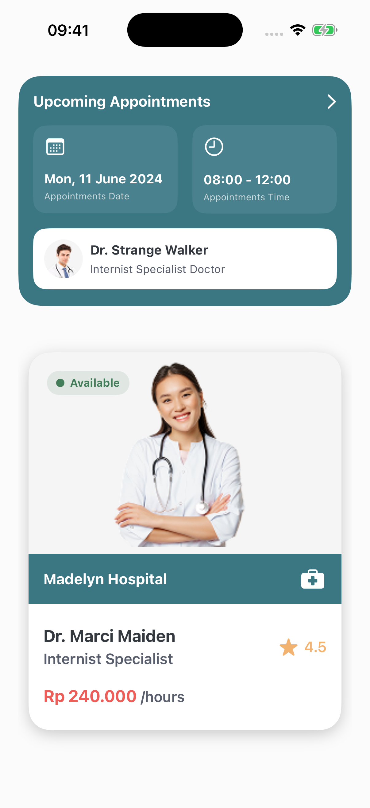

# Doctor App

A native medical app interface built with SwiftUI: an upcoming doctor appointment and specialist cards.

## Screenshot



## What's implemented

- Upcoming appointment card with date, time and doctor details.
- Doctor profile with photo, availability status, clinic, rating and price.
- A second profile variant with certification, experience and a **Book Now** button.
- Reusable SwiftUI components, with colors and images in the asset catalog.

This is a UI prototype with static demo data. The booking button does nothing yet; there is no backend, authentication or appointment booking.

## Run

Requirements: macOS, Xcode 26.4 or later, and a simulator or device running iOS 26.4 or later.

```bash
git clone https://github.com/Ceyhun1999/doctor_app.git
cd doctor_app
open doctor.xcodeproj
```

In Xcode, select the `doctor` scheme and a device, then press **Run** (`⌘R`). For a physical device, set your own team in **Signing & Capabilities**.

Build for the simulator from the terminal:

```bash
xcodebuild -project doctor.xcodeproj \
  -scheme doctor \
  -configuration Debug \
  -sdk iphonesimulator \
  -derivedDataPath /tmp/doctor-app-build \
  CODE_SIGNING_ALLOWED=NO build
```

There are no external dependencies.

## Project structure

```text
doctor/
├── doctorApp.swift                 # Entry point
├── DoctorView.swift                # Home screen
├── UpComingAppointmentCard/        # Appointment card
├── DoctorProfileCard/              # Doctor profile
├── DoctorProfileCard2/             # Alternative profile
└── Assets.xcassets/                # Images and colors
docs/screenshots/                  # App screenshots
doctor.xcodeproj/                  # Xcode project
```
