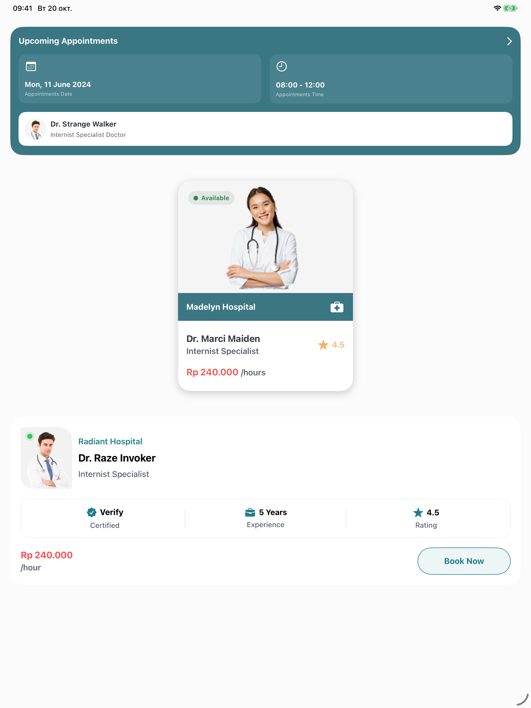

# Doctor App

Нативный интерфейс медицинского приложения на SwiftUI: ближайшая запись к врачу и карточки специалистов.

## Скриншоты

Скриншоты работающего приложения в iOS Simulator (iOS 26.4).

| iPhone 17 Pro | iPad Pro 13″ |
| :---: | :---: |
|  |  |

## Что реализовано

- Карточка предстоящего приёма с датой, временем и данными врача.
- Профиль врача с фотографией, статусом доступности, клиникой, рейтингом и стоимостью.
- Второй вариант профиля с сертификацией, опытом и кнопкой **Book Now**.
- Переиспользуемые SwiftUI-компоненты, цвета и изображения в Asset Catalog.

Это UI-прототип со статическими демонстрационными данными. Кнопка бронирования пока не выполняет действий; сервер, авторизация и запись на приём не подключены.

## Запуск

Требования: macOS, Xcode 26.4 или новее и симулятор либо устройство с iOS/iPadOS 26.4 или новее.

```bash
git clone https://github.com/Ceyhun1999/doctor_app.git
cd doctor_app
open doctor.xcodeproj
```

В Xcode выберите схему `doctor`, устройство и нажмите **Run** (`⌘R`). Для физического устройства настройте свою команду в **Signing & Capabilities**.

Сборка для симулятора из терминала:

```bash
xcodebuild -project doctor.xcodeproj \
  -scheme doctor \
  -configuration Debug \
  -sdk iphonesimulator \
  -derivedDataPath /tmp/doctor-app-build \
  CODE_SIGNING_ALLOWED=NO build
```

Внешние зависимости отсутствуют.

## Структура

```text
doctor/
├── doctorApp.swift                 # Точка входа
├── DoctorView.swift                # Главный экран
├── UpComingAppointmentCard/        # Карточка приёма
├── DoctorProfileCard/              # Профиль врача
├── DoctorProfileCard2/             # Альтернативный профиль
└── Assets.xcassets/                # Изображения и цвета
docs/screenshots/                  # Скриншоты приложения
doctor.xcodeproj/                  # Проект Xcode
```
